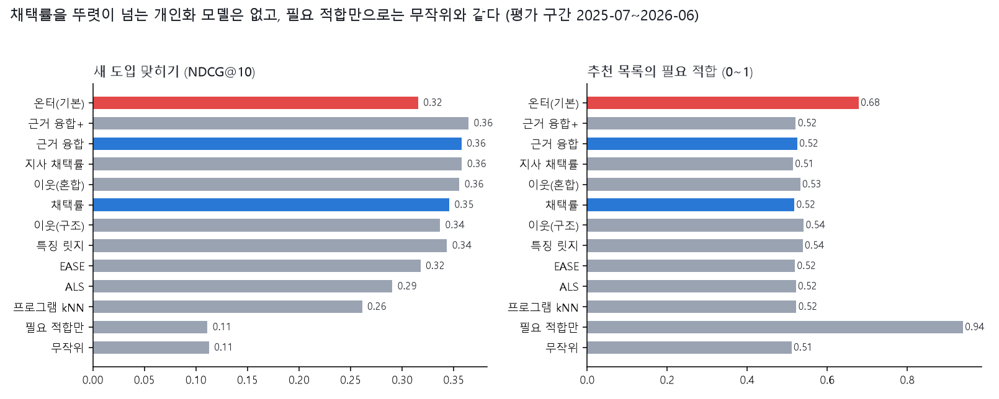
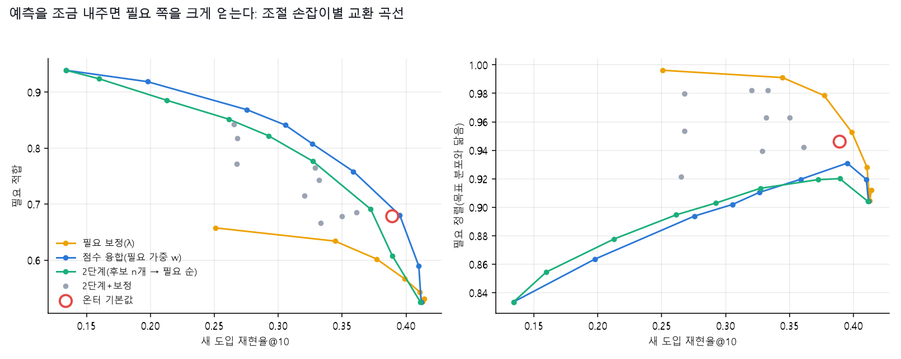

# 실험 보고서: 비교 실험과 절제 실험

자동 생성: `python experiments/make_report.py`. 표의 숫자는 `results/tables/*.csv`에서 그대로 옮겼다. 해석은 2026-11-18 실행 결과 기준이다.

## 0. 평가 설계

- **분할**: 롤링 오리진 3개. A(학습 2024 → 평가 2025), B(학습 2024-01~2025-06 → 평가 2025-07~2026-06, 주 분할), C(학습 2024~2025 → 평가 2026 상반기, 보고 지연 위험).
- **대상**: 추천 대상 표준 프로그램 96종. 평가 단지는 학습 구간 기록 8건 이상이고 평가 구간에 기록이 있는 단지.
- **새 도입 맞히기**: 학습 구간에 한 번도 안 한 프로그램 가운데 평가 구간에 새로 한 것을 상위 10개 안에 얼마나 넣는가(NDCG@10, 재현율@10, AUC). 예측 타당도 지표이고 정답이 아니다.
- **필요 쪽 지표**: 필요 적합(need_gain, 목록에 든 프로그램의 필요 적합 백분위 평균), 필요 정렬(need_align, 목록의 분야 분포와 단지 목표 분포의 1−JSD). 설계 목표를 재는 지표라서 필요를 쓰는 방법에 유리하다. 그래서 외부 기준(해피콜 수요, 전문가 판정)을 따로 둔다.
- **수요 정렬**(demand_align): 추천 목록을 전국으로 합친 수요 항목 분포와 해피콜 수요 분포의 1−JSD.
- **검정**: 단지 단위 짝지은 부트스트랩(4,000회), 여러 모델 비교는 Holm 보정.

## 1. E3 순위 모델 비교

### 주 분할 B

| model | ndcg10 | recall10 | auc | need_align | need_gain | demand_align | pop_pct | coverage | n |
|---|---|---|---|---|---|---|---|---|---|
| random | 0.113 | 0.134 | 0.494 | 0.894 | 0.511 | 0.947 | 0.439 | 1.000 | 288 |
| pop | 0.346 | 0.404 | 0.760 | 0.883 | 0.517 | 0.940 | 0.867 | 0.438 | 288 |
| pop_recent | 0.338 | 0.401 | 0.761 | 0.899 | 0.516 | 0.958 | 0.863 | 0.438 | 288 |
| diffusion | 0.346 | 0.410 | 0.745 | 0.911 | 0.520 | 0.947 | 0.846 | 0.438 | 288 |
| branch_pop | 0.358 | 0.414 | 0.764 | 0.894 | 0.514 | 0.958 | 0.830 | 0.698 | 288 |
| type_pop | 0.358 | 0.413 | 0.763 | 0.904 | 0.550 | 0.954 | 0.854 | 0.490 | 288 |
| knn_demo | 0.346 | 0.390 | 0.738 | 0.902 | 0.544 | 0.964 | 0.818 | 0.740 | 288 |
| knn_struct | 0.337 | 0.377 | 0.738 | 0.912 | 0.541 | 0.969 | 0.818 | 0.771 | 288 |
| knn_need | 0.339 | 0.387 | 0.737 | 0.907 | 0.547 | 0.966 | 0.819 | 0.760 | 288 |
| knn_behav | 0.344 | 0.397 | 0.748 | 0.896 | 0.526 | 0.956 | 0.833 | 0.698 | 288 |
| knn_geo | 0.345 | 0.387 | 0.742 | 0.889 | 0.515 | 0.953 | 0.792 | 0.906 | 288 |
| knn_branch | 0.341 | 0.389 | 0.747 | 0.893 | 0.514 | 0.959 | 0.795 | 0.854 | 288 |
| knn_hybrid | 0.355 | 0.404 | 0.753 | 0.908 | 0.532 | 0.971 | 0.819 | 0.688 | 288 |
| itemknn | 0.261 | 0.321 | 0.702 | 0.899 | 0.522 | 0.974 | 0.671 | 0.948 | 288 |
| ease | 0.318 | 0.362 | 0.710 | 0.905 | 0.519 | 0.967 | 0.790 | 0.833 | 288 |
| svd | 0.297 | 0.335 | 0.643 | 0.902 | 0.515 | 0.962 | 0.726 | 0.823 | 288 |
| als | 0.290 | 0.347 | 0.693 | 0.901 | 0.521 | 0.963 | 0.764 | 0.927 | 288 |
| ridge | 0.343 | 0.382 | 0.723 | 0.909 | 0.538 | 0.968 | 0.799 | 0.823 | 288 |
| need_fit | 0.111 | 0.134 | 0.515 | 0.834 | 0.939 | 0.938 | 0.448 | 0.948 | 288 |
| evidence | 0.357 | 0.412 | 0.763 | 0.904 | 0.525 | 0.962 | 0.843 | 0.552 | 288 |
| evidence+ | 0.364 | 0.426 | 0.770 | 0.899 | 0.521 | 0.957 | 0.852 | 0.500 | 288 |
| onter | 0.315 | 0.389 |  | 0.946 | 0.678 | 0.967 | 0.815 | 0.615 | 288 |

### 분할별 NDCG@10

| model | A | B | C |
|---|---|---|---|
| random | 0.117 | 0.113 | 0.096 |
| pop | 0.382 | 0.346 | 0.356 |
| pop_recent | 0.382 | 0.338 | 0.353 |
| diffusion | 0.326 | 0.346 | 0.277 |
| branch_pop | 0.393 | 0.358 | 0.356 |
| type_pop | 0.383 | 0.358 | 0.368 |
| knn_demo | 0.368 | 0.346 | 0.343 |
| knn_struct | 0.367 | 0.337 | 0.334 |
| knn_need | 0.361 | 0.339 | 0.337 |
| knn_behav | 0.372 | 0.344 | 0.330 |
| knn_geo | 0.372 | 0.345 | 0.320 |
| knn_branch | 0.376 | 0.340 | 0.321 |
| knn_hybrid | 0.390 | 0.355 | 0.347 |
| itemknn | 0.266 | 0.261 | 0.212 |
| ease | 0.343 | 0.318 | 0.298 |
| svd | 0.295 | 0.297 | 0.248 |
| als | 0.301 | 0.290 | 0.292 |
| ridge | 0.370 | 0.343 | 0.333 |
| need_fit | 0.117 | 0.111 | 0.094 |
| evidence | 0.390 | 0.358 | 0.349 |
| evidence+ | 0.397 | 0.364 | 0.327 |
| ltr_gbdt |  |  | 0.330 |
| ltr_gbdt(-need_fit) |  |  | 0.312 |
| onter | 0.331 | 0.315 | 0.294 |

### 채택률 기준선 대비 차이(주 분할, NDCG@10)

| model | diff | lo | hi | p | p_holm |
|---|---|---|---|---|---|
| random | -0.233 | -0.260 | -0.205 | 0.000 | 0.006 |
| pop_recent | -0.008 | -0.015 | -0.001 | 0.018 | 0.240 |
| diffusion | 0.001 | -0.013 | 0.015 | 0.898 | 1.000 |
| branch_pop | 0.012 | -0.000 | 0.025 | 0.062 | 0.625 |
| type_pop | 0.013 | 0.002 | 0.023 | 0.018 | 0.240 |
| knn_demo | 0.000 | -0.017 | 0.017 | 0.981 | 1.000 |
| knn_struct | -0.009 | -0.027 | 0.008 | 0.298 | 1.000 |
| knn_need | -0.006 | -0.022 | 0.010 | 0.429 | 1.000 |
| knn_behav | -0.001 | -0.015 | 0.012 | 0.863 | 1.000 |
| knn_geo | -0.001 | -0.017 | 0.015 | 0.909 | 1.000 |
| knn_branch | -0.005 | -0.023 | 0.012 | 0.556 | 1.000 |
| knn_hybrid | 0.010 | -0.005 | 0.025 | 0.197 | 1.000 |
| itemknn | -0.084 | -0.109 | -0.060 | 0.000 | 0.006 |
| ease | -0.028 | -0.046 | -0.010 | 0.005 | 0.075 |
| svd | -0.049 | -0.072 | -0.025 | 0.000 | 0.006 |
| als | -0.055 | -0.076 | -0.035 | 0.000 | 0.006 |
| ridge | -0.002 | -0.019 | 0.014 | 0.782 | 1.000 |
| need_fit | -0.234 | -0.262 | -0.207 | 0.000 | 0.006 |
| evidence | 0.012 | -0.000 | 0.023 | 0.051 | 0.561 |
| evidence+ | 0.019 | 0.008 | 0.030 | 0.000 | 0.006 |
| onter_fusion(w=0.4) | -0.064 | -0.088 | -0.042 | 0.000 | 0.006 |
| onter_two_stage(n=20) | -0.083 | -0.109 | -0.058 | 0.000 | 0.006 |
| onter_calib(λ=0.5) | -0.032 | -0.053 | -0.011 | 0.002 | 0.032 |
| onter | -0.030 | -0.052 | -0.009 | 0.011 | 0.147 |

**읽는 법**

1. **채택률(pop)이 매우 강하다.** 이웃·EASE·행렬분해·특징 릿지 어느 것도 Holm 보정 후 채택률을 넘지 못했다. 지사 채택률과 확산 속도까지 섞은 `evidence+`만 +0.019로 유의했다. 새 도입은 '그 단지다움'보다 '전국에서 얼마나 퍼졌나'로 설명된다.
2. **필요 적합만 쓰면 무작위와 같다**(NDCG 0.111 대 0.113, AUC 0.51). 단지의 구조적 필요는 실제 도입을 예측하지 못한다. 문제 정의('프로그램이 필요를 따라가지 않는다')를 추천 모델의 눈으로 다시 확인한 결과다.
3. **행동 지도학습(GBDT 순위 학습)도 채택률 수준이다**(분할 C). 필요 적합 특징을 빼도 넣어도 차이가 작다. 도입 기록을 정답으로 학습하면 현상 유지를 복제할 뿐이다.
4. 그래서 온터는 도입 예측을 목표로 삼지 않는다. 근거 점수는 '현장이 실제로 고를 만한 범위'를 지키는 데 쓰고, 그 안에서 필요 쪽으로 기울인다.

### 분야별 순위 품질(분야 안 새 도입 NDCG@3)

| domain | label | evidence | need_fit | onter_score | pop |
|---|---|---|---|---|---|
| N1 | 안부와 관계 | 0.553 | 0.313 | 0.564 | 0.597 |
| N2 | 생활과 경제 | 0.604 | 0.338 | 0.576 | 0.549 |
| N3 | 건강과 돌봄 | 0.624 | 0.253 | 0.616 | 0.610 |
| N4 | 주거환경과 생활안전 | 0.318 | 0.162 | 0.298 | 0.297 |
| N5 | 문화와 활동 | 0.578 | 0.190 | 0.572 | 0.597 |
| N6 | 일자리와 학습 | 0.761 | 0.521 | 0.751 | 0.723 |

### 기록 없는 단지 모의(학습 이력을 가린 단지의 평가 구간 운영 맞히기)

| model | ndcg10 | lo | hi | recall10 | auc | n |
|---|---|---|---|---|---|---|
| pop | 0.516 | 0.492 | 0.539 | 0.313 | 0.791 | 290 |
| branch_pop | 0.538 | 0.515 | 0.561 | 0.332 | 0.805 | 290 |
| type_pop | 0.535 | 0.511 | 0.558 | 0.329 | 0.796 | 290 |
| knn_struct | 0.524 | 0.499 | 0.547 | 0.328 | 0.785 | 290 |
| knn_geo | 0.543 | 0.519 | 0.565 | 0.340 | 0.792 | 290 |
| knn_hybrid | 0.538 | 0.514 | 0.562 | 0.331 | 0.795 | 290 |
| ridge | 0.519 | 0.493 | 0.544 | 0.323 | 0.772 | 290 |
| need_fit | 0.190 | 0.173 | 0.207 | 0.113 | 0.521 | 290 |

기록이 없어도 지사·거리 이웃의 채택률로 채택률 기준선보다 조금 낫게 시작할 수 있다(구간이 겹쳐 차이는 작다). 기록 없는 12개 단지에는 구조+거리 이웃을 쓴다.

### 집단별 성능(온터 기본값 대 채택률)

| group | level | n | onter_ndcg | pop_ndcg | onter_align | pop_align |
|---|---|---|---|---|---|---|
| 규모 | 대 | 97 | 0.307 | 0.351 | 0.955 | 0.887 |
| 규모 | 소 | 97 | 0.323 | 0.346 | 0.938 | 0.873 |
| 규모 | 중 | 96 | 0.316 | 0.339 | 0.945 | 0.890 |
| 주거복지사 | 배치 | 102 | 0.308 | 0.344 | 0.959 | 0.881 |
| 주거복지사 | 미배치 | 188 | 0.320 | 0.347 | 0.939 | 0.885 |
| 지역 | 대도시 자치구 | 90 | 0.287 | 0.318 | 0.949 | 0.889 |
| 지역 | 시 지역 | 169 | 0.334 | 0.364 | 0.947 | 0.883 |
| 지역 | 군 지역 | 31 | 0.296 | 0.327 | 0.932 | 0.870 |
| 유형 | S2 | 127 | 0.311 | 0.349 | 0.958 | 0.879 |
| 유형 | S3 | 24 | 0.266 | 0.271 | 0.933 | 0.894 |
| 유형 | S1 | 139 | 0.328 | 0.355 | 0.937 | 0.886 |

작은 단지·주거복지사 미배치 단지에서 성능이 더 나쁘지 않다. 원격 유형(S3, 24곳)은 두 방법 모두 낮다.

## 2. E4 교환 관계와 절제

**기본값 고르기**: 검증 분할 A에서 '새 도입 재현율이 근거 모델의 90% 이상이고 필요 정렬 0.95 이상'인 구성 중 필요 적합이 가장 큰 것 → 필요 가중 w=0.2, 보정 λ=0.25. 주 분할 B에서 재현율 0.389(근거 0.412의 95%), 필요 적합 0.68(근거 0.52), 필요 정렬 0.946(근거 0.904).

| model | knob | ndcg10 | recall10 | need_align | need_gain | demand_align | coverage |
|---|---|---|---|---|---|---|---|
| fusion | 0.000 | 0.357 | 0.412 | 0.904 | 0.525 | 0.963 | 0.552 |
| fusion | 0.100 | 0.352 | 0.410 | 0.920 | 0.589 | 0.964 | 0.562 |
| fusion | 0.200 | 0.337 | 0.395 | 0.931 | 0.680 | 0.962 | 0.615 |
| fusion | 0.300 | 0.307 | 0.359 | 0.920 | 0.758 | 0.965 | 0.729 |
| fusion | 0.400 | 0.281 | 0.327 | 0.910 | 0.808 | 0.970 | 0.802 |
| fusion | 0.500 | 0.263 | 0.305 | 0.902 | 0.841 | 0.973 | 0.823 |
| fusion | 0.600 | 0.243 | 0.276 | 0.894 | 0.869 | 0.971 | 0.854 |
| fusion | 0.800 | 0.179 | 0.198 | 0.864 | 0.919 | 0.952 | 0.927 |
| fusion | 1.000 | 0.111 | 0.134 | 0.834 | 0.939 | 0.938 | 0.948 |
| two_stage | 10.000 | 0.328 | 0.411 | 0.904 | 0.525 | 0.962 | 0.542 |
| two_stage | 12.000 | 0.314 | 0.389 | 0.920 | 0.608 | 0.951 | 0.604 |
| two_stage | 15.000 | 0.297 | 0.372 | 0.919 | 0.691 | 0.958 | 0.667 |
| two_stage | 20.000 | 0.262 | 0.327 | 0.913 | 0.776 | 0.969 | 0.740 |
| two_stage | 25.000 | 0.234 | 0.292 | 0.903 | 0.822 | 0.974 | 0.833 |
| two_stage | 30.000 | 0.212 | 0.261 | 0.895 | 0.852 | 0.974 | 0.885 |
| two_stage | 40.000 | 0.173 | 0.213 | 0.878 | 0.885 | 0.968 | 0.917 |
| two_stage | 60.000 | 0.131 | 0.160 | 0.855 | 0.924 | 0.944 | 0.969 |
| two_stage | 96.000 | 0.111 | 0.134 | 0.834 | 0.939 | 0.938 | 0.948 |
| calib | 0.000 | 0.359 | 0.413 | 0.904 | 0.526 | 0.962 | 0.542 |
| calib | 0.100 | 0.344 | 0.414 | 0.912 | 0.531 | 0.963 | 0.552 |
| calib | 0.250 | 0.329 | 0.411 | 0.928 | 0.543 | 0.970 | 0.562 |
| calib | 0.500 | 0.313 | 0.399 | 0.953 | 0.567 | 0.976 | 0.615 |
| calib | 0.750 | 0.285 | 0.377 | 0.979 | 0.602 | 0.981 | 0.667 |
| calib | 0.900 | 0.255 | 0.344 | 0.991 | 0.634 | 0.980 | 0.760 |
| calib | 0.970 | 0.195 | 0.251 | 0.996 | 0.657 | 0.973 | 0.812 |
| two_stage+calib | 15.250 | 0.287 | 0.361 | 0.942 | 0.685 | 0.965 | 0.656 |
| two_stage+calib | 15.500 | 0.272 | 0.350 | 0.963 | 0.678 | 0.975 | 0.677 |
| two_stage+calib | 15.750 | 0.258 | 0.333 | 0.982 | 0.666 | 0.981 | 0.708 |
| two_stage+calib | 20.250 | 0.262 | 0.329 | 0.939 | 0.765 | 0.974 | 0.740 |
| two_stage+calib | 20.500 | 0.260 | 0.332 | 0.963 | 0.743 | 0.978 | 0.740 |
| two_stage+calib | 20.750 | 0.248 | 0.321 | 0.982 | 0.715 | 0.982 | 0.760 |
| two_stage+calib | 30.250 | 0.217 | 0.265 | 0.921 | 0.843 | 0.974 | 0.875 |
| two_stage+calib | 30.500 | 0.220 | 0.268 | 0.954 | 0.817 | 0.977 | 0.875 |
| two_stage+calib | 30.750 | 0.214 | 0.268 | 0.980 | 0.772 | 0.977 | 0.896 |

### 절제(주 분할, 기본값에서 하나씩 바꿈. d_는 기본값 대비 차이)

| model | ndcg10 | recall10 | need_align | need_gain | demand_align | coverage | d_ndcg | p_ndcg | d_align | p_align |
|---|---|---|---|---|---|---|---|---|---|---|
| 기본(온터): 융합 w=0.2 + 보정 λ=0.25 | 0.315 | 0.389 | 0.946 | 0.678 | 0.967 | 0.615 | 0.000 | 1.000 | 0.000 | 1.000 |
| − 필요 보정(λ=0) | 0.337 | 0.395 | 0.931 | 0.680 | 0.962 | 0.615 | 0.021 | 0.007 | -0.015 | 0.000 |
| − 필요 점수(근거만 + 보정) | 0.329 | 0.411 | 0.928 | 0.543 | 0.970 | 0.562 | 0.014 | 0.021 | -0.018 | 0.000 |
| − 필요 전부(근거만) | 0.357 | 0.412 | 0.904 | 0.525 | 0.962 | 0.552 | 0.042 | 0.000 | -0.042 | 0.000 |
| − 근거 성분 knn_hybrid | 0.312 | 0.390 | 0.945 | 0.672 | 0.968 | 0.635 | -0.003 | 0.552 | -0.001 | 0.344 |
| − 근거 성분 ease | 0.310 | 0.386 | 0.946 | 0.677 | 0.969 | 0.552 | -0.006 | 0.300 | -0.000 | 0.936 |
| − 근거 성분 pop | 0.307 | 0.379 | 0.949 | 0.680 | 0.971 | 0.823 | -0.008 | 0.086 | 0.003 | 0.029 |
| + 근거에 지사 채택률·확산 속도 | 0.313 | 0.394 | 0.945 | 0.672 | 0.965 | 0.583 | -0.002 | 0.727 | -0.001 | 0.406 |
| 이웃 정의 = struct | 0.317 | 0.395 | 0.948 | 0.682 | 0.969 | 0.615 | 0.001 | 0.778 | 0.001 | 0.272 |
| 이웃 정의 = behav | 0.313 | 0.389 | 0.945 | 0.679 | 0.966 | 0.656 | -0.003 | 0.625 | -0.001 | 0.256 |
| 이웃 정의 = geo | 0.310 | 0.390 | 0.947 | 0.669 | 0.965 | 0.667 | -0.005 | 0.335 | 0.000 | 0.780 |
| 이웃 정의 = need | 0.306 | 0.380 | 0.947 | 0.686 | 0.968 | 0.625 | -0.009 | 0.043 | 0.000 | 0.728 |
| 이웃 정의 = branch | 0.315 | 0.392 | 0.945 | 0.669 | 0.965 | 0.646 | -0.001 | 0.930 | -0.002 | 0.193 |
| 이웃 수 k=5 | 0.309 | 0.375 | 0.947 | 0.675 | 0.968 | 0.708 | -0.007 | 0.246 | 0.001 | 0.349 |
| 이웃 수 k=10 | 0.316 | 0.387 | 0.947 | 0.677 | 0.969 | 0.667 | 0.001 | 0.846 | 0.001 | 0.254 |
| 이웃 수 k=40 | 0.319 | 0.397 | 0.947 | 0.680 | 0.968 | 0.625 | 0.003 | 0.400 | 0.001 | 0.310 |
| 필요 지수에 이용 실적 포함(SE) | 0.319 | 0.394 | 0.943 | 0.656 | 0.969 | 0.625 | 0.003 | 0.438 | -0.003 | 0.041 |
| 대상 적합 빼기 | 0.313 | 0.384 | 0.946 | 0.663 | 0.967 | 0.635 | -0.002 | 0.597 | -0.000 | 0.789 |
| 목표 분포: base=uniform, β=2.0 | 0.314 | 0.387 | 0.944 | 0.678 | 0.966 | 0.615 | -0.001 | 0.710 | -0.003 | 0.000 |
| 목표 분포: base=supply, β=2.0 | 0.310 | 0.386 | 0.941 | 0.681 | 0.963 | 0.625 | -0.005 | 0.112 | -0.005 | 0.000 |
| 목표 분포: base=demand_national, β=2.0 | 0.315 | 0.389 | 0.947 | 0.679 | 0.967 | 0.615 | -0.000 | 0.553 | 0.001 | 0.054 |
| 목표 분포: base=demand, β=0.0 | 0.309 | 0.384 | 0.949 | 0.661 | 0.968 | 0.625 | -0.006 | 0.111 | 0.003 | 0.002 |
| 목표 분포: base=demand, β=1.0 | 0.309 | 0.383 | 0.948 | 0.670 | 0.967 | 0.615 | -0.006 | 0.014 | 0.002 | 0.008 |
| 목표 분포: base=demand, β=4.0 | 0.312 | 0.385 | 0.944 | 0.692 | 0.968 | 0.635 | -0.004 | 0.339 | -0.002 | 0.017 |

**읽는 법**

1. 필요 점수를 빼면 필요 적합이 0.68 → 0.54로 떨어지고, 보정을 빼면 필요 정렬이 0.946 → 0.931로 떨어진다. 두 장치는 서로 다른 일을 한다(점수는 '맞는 프로그램', 보정은 '분야 구성').
2. 근거 성분(이웃·EASE·채택률)을 하나씩 빼도, 이웃 정의나 이웃 수를 바꿔도 유의한 차이가 없다. 근거 쪽은 무엇을 쓰든 비슷하므로 설명하기 쉬운 '비슷한 단지 몇 곳이 운영'을 남긴다.
3. 목표 분포의 기준(해피콜·현 공급·균등)과 기울기 β는 도입 예측에 거의 영향이 없다. 해피콜 연령 보정 합성 추정은 전국 분포와 사실상 같다(단지 간 표준편차 0.1~0.5%p).
4. 필요 지수에 이용 실적(홈닥터)을 넣어도 나아지지 않는다.

## 3. E1 필요 지수

- 여섯 분야 필요 백분위의 주성분 비중: [0.686, 0.168, 0.062, 0.051, 0.024, 0.008]. 첫 축이 69%다. N1~N4는 '고령·영구임대' 한 축으로 함께 움직이고 N6은 그 반대다. 지금 자료로는 분야를 여섯 개로 따로 가를 힘이 약하다(단지별 1인 가구·수급·장애 자료가 없기 때문).
- 필요 상위 1/3이면서 공급 하위 1/3인 '우선 검토' 분야가 하나 이상인 단지: 111곳 / 306곳.

### 가중치·지표를 흔들었을 때의 안정성

| domain | label | width_median | width_p90 | top_third_robust | n_indicators |
|---|---|---|---|---|---|
| N1 | 안부와 관계 | 0.072 | 0.177 | 1.000 | 4 |
| N2 | 생활과 경제 | 0.013 | 0.060 | 1.000 | 3 |
| N3 | 건강과 돌봄 | 0.170 | 0.400 | 0.850 | 3 |
| N4 | 주거환경과 생활안전 | 0.215 | 0.348 | 1.000 | 4 |
| N5 | 문화와 활동 | 0.315 | 0.551 | 0.776 | 3 |
| N6 | 일자리와 학습 | 0.057 | 0.153 | 1.000 | 2 |

### 필요(구조) ↔ 공급 순위상관

| domain | label | rho | lo | hi | n | p |
|---|---|---|---|---|---|---|
| N1 | 안부와 관계 | 0.058 | -0.053 | 0.173 | 306 | 0.316 |
| N2 | 생활과 경제 | 0.002 | -0.120 | 0.119 | 306 | 0.974 |
| N3 | 건강과 돌봄 | 0.140 | 0.020 | 0.237 | 306 | 0.012 |
| N4 | 주거환경과 생활안전 | 0.013 | -0.097 | 0.121 | 306 | 0.828 |
| N5 | 문화와 활동 | 0.098 | -0.009 | 0.205 | 306 | 0.089 |
| N6 | 일자리와 학습 | 0.199 | 0.091 | 0.316 | 306 | 0.000 |

### 수렴 타당도(지수에 넣지 않은 자료와의 관계)

| domain | criterion | rho | lo | hi | n | p | partial_rho_size |
|---|---|---|---|---|---|---|---|
| N1 | 홈닥터 생활지원 | -0.097 | -0.216 | 0.006 | 318 | 0.096 | -0.045 |
| N2 | 홈닥터 경제지원 | -0.100 | -0.213 | 0.011 | 318 | 0.070 | -0.162 |
| N3 | 홈닥터 의료지원 | -0.137 | -0.245 | -0.018 | 318 | 0.016 | -0.126 |
| N4 | 홈닥터 가사지원 | -0.073 | -0.181 | 0.031 | 318 | 0.188 | 0.008 |
| N1 | 홈닥터 전체 | -0.222 | -0.332 | -0.124 | 318 | 0.000 | -0.158 |
| N1 | 과거 고독사 기록 유무(점검 전용) | 0.417 | 0.313 | 0.505 | 318 | 0.000 | 0.363 |

**읽는 법**: 구조 필요 지수는 홈닥터 이용 실적과 같은 방향으로 움직이지 않는다(약한 음의 상관). 홈닥터 100세대당 건수가 작은 단지에서 크게 나오는 자료 특성과 공급 의존성 때문으로 보이며, 이용 실적으로는 필요 지수를 검증할 수 없다. N1은 과거 고독사 기록 유무와 ρ=+0.42(규모 통제 +0.36)로 같은 방향이다(점검 전용, 입력·발표 훅으로 쓰지 않음). **결론: 필요 지수는 외부 검증이 부족하다. 전문가 판정(시트 C·D)이 필요하다.**

### 단지 유형(구조 특징 군집)

| k | silhouette | stability_ari |
|---|---|---|
| 3 | 0.253 | 0.881 |
| 4 | 0.260 | 0.776 |
| 5 | 0.224 | 0.719 |
| 6 | 0.210 | 0.757 |
| 7 | 0.216 | 0.796 |
| 8 | 0.218 | 0.753 |

| type | n | traits |
|---|---|---|
| S1 | 153 | perm(-0.8) / parking(+0.8) / age60(-0.8) / pph(+0.8) |
| S2 | 128 | parking(-1.0) / perm(+1.0) / national(-0.9) / years(+0.9) |
| S3 | 37 | d_영유아교육돌봄시설(+1.9) / d_온종일돌봄센터(+1.9) / d_어린이집(+1.9) / d_약국(+1.8) |

## 4. E2 유사 단지 정의

| fold | sim | ndcg10 | recall10 | auc | d_vs_pop | p_vs_pop |
|---|---|---|---|---|---|---|
| A | demo | 0.368 | 0.359 | 0.723 | -0.013 | 0.113 |
| A | struct | 0.367 | 0.359 | 0.729 | -0.015 | 0.077 |
| A | need | 0.361 | 0.359 | 0.728 | -0.020 | 0.013 |
| A | behav | 0.372 | 0.378 | 0.726 | -0.009 | 0.197 |
| A | geo | 0.372 | 0.365 | 0.734 | -0.009 | 0.322 |
| A | branch | 0.377 | 0.360 | 0.736 | -0.005 | 0.608 |
| A | hybrid | 0.390 | 0.387 | 0.743 | 0.009 | 0.262 |
| A | random | 0.359 | 0.354 | 0.712 | -0.022 | 0.004 |
| B | demo | 0.346 | 0.390 | 0.738 | -0.001 | 0.943 |
| B | struct | 0.337 | 0.377 | 0.738 | -0.010 | 0.254 |
| B | need | 0.339 | 0.387 | 0.737 | -0.007 | 0.361 |
| B | behav | 0.344 | 0.397 | 0.748 | -0.002 | 0.755 |
| B | geo | 0.345 | 0.387 | 0.742 | -0.002 | 0.813 |
| B | branch | 0.341 | 0.389 | 0.747 | -0.006 | 0.486 |
| B | hybrid | 0.355 | 0.404 | 0.753 | 0.009 | 0.255 |
| B | random | 0.322 | 0.371 | 0.723 | -0.025 | 0.000 |

| fold | sim | struct_dist | need_absdiff | behav_cos | same_branch | km_median |
|---|---|---|---|---|---|---|
| A | demo | 5.984 | 0.155 | 0.216 | 0.140 | 144.813 |
| A | struct | 4.218 | 0.163 | 0.223 | 0.184 | 139.349 |
| A | need | 5.946 | 0.092 | 0.208 | 0.108 | 165.193 |
| A | behav | 7.402 | 0.289 | 0.458 | 0.214 | 142.203 |
| A | geo | 7.306 | 0.316 | 0.244 | 0.788 | 11.162 |
| A | branch | 7.563 | 0.323 | 0.231 | 0.988 | 32.334 |
| A | hybrid | 4.988 | 0.181 | 0.342 | 0.389 | 60.293 |
| A | random | 7.990 | 0.338 | 0.194 | 0.078 | 172.549 |
| B | demo | 5.980 | 0.155 | 0.261 | 0.140 | 145.307 |
| B | struct | 4.214 | 0.162 | 0.270 | 0.184 | 139.376 |
| B | need | 5.942 | 0.092 | 0.256 | 0.108 | 166.039 |
| B | behav | 7.244 | 0.283 | 0.484 | 0.246 | 139.782 |
| B | geo | 7.308 | 0.317 | 0.299 | 0.792 | 11.135 |
| B | branch | 7.602 | 0.324 | 0.282 | 0.988 | 32.622 |
| B | hybrid | 4.996 | 0.182 | 0.385 | 0.409 | 57.246 |
| B | random | 8.037 | 0.338 | 0.235 | 0.078 | 172.737 |

**읽는 법**: 어떤 정의로 이웃을 골라도 새 도입 예측은 채택률과 유의하게 다르지 않다. 혼합(구조 0.5·행동 0.3·거리 0.2)이 두 분할에서 가장 높지만 차이는 구간 안이다. 대신 성질이 다르다. 구조 이웃은 주민·주거가 닮았고(구조 거리 4.2) 멀리 있다(중앙 139km). 거리 이웃은 79%가 같은 지사라 협력기관을 공유할 수 있지만 주민 구성은 무작위 수준이다. 혼합은 그 중간이다(구조 거리 5.0, 같은 지사 41%, 57km). 화면에서는 '구성이 닮은 단지'와 '가까운 단지'를 따로 보여 주는 편이 정직하다.

## 5. E5 실행 검토

| score | auc | lo | hi | d_ndcg | p |
|---|---|---|---|---|---|
| 실행 가능성(종합) | 0.484 | 0.468 | 0.499 |  |  |
| 성분: partner | 0.492 | 0.475 | 0.510 |  |  |
| 성분: space | 0.475 | 0.461 | 0.489 |  |  |
| 성분: staff | 0.520 | 0.505 | 0.535 |  |  |
| 성분: budget | 0.432 | 0.413 | 0.450 |  |  |
| 근거 + 실행 가능성(w=0.1) NDCG@10 차 | 0.762 | -0.027 | -0.002 | -0.014 | 0.020 |
| 근거 + 실행 가능성(w=0.2) NDCG@10 차 | 0.754 | -0.051 | -0.016 | -0.034 | 0.000 |
| 근거 + 실행 가능성(w=0.3) NDCG@10 차 | 0.739 | -0.088 | -0.046 | -0.067 | 0.000 |

**읽는 법**: 규칙으로 만든 실행 가능성 점수는 새 도입을 예측하지 못한다(AUC 0.48). 점수에 섞으면 오히려 나빠진다. 그래서 **순위 점수에 넣지 않고 점검표와 제약 조건으로만 쓴다.** 성분 가운데 인력(staff)만 0.52로 방향이 맞았다.

| condition | level | pairs | new_rate | lo | hi |
|---|---|---|---|---|---|
| 협력기관이 필요한 프로그램(협력 표기율 40% 이상) | 협력 여건 높음(0.85 이상) | 765 | 0.119 | 0.096 | 0.142 |
| 협력기관이 필요한 프로그램(협력 표기율 40% 이상) | 중간 | 850 | 0.067 | 0.050 | 0.084 |
| 협력기관이 필요한 프로그램(협력 표기율 40% 이상) | 낮음(0.55 미만) | 1520 | 0.101 | 0.086 | 0.117 |
| 세대 방문형 프로그램(방문 비중 30% 이상) | 주거복지사 배치 | 1528 | 0.094 | 0.079 | 0.108 |
| 그 밖의 프로그램 | 주거복지사 배치 | 5491 | 0.094 | 0.087 | 0.102 |
| 세대 방문형 프로그램(방문 비중 30% 이상) | 미배치 | 3221 | 0.056 | 0.048 | 0.064 |
| 그 밖의 프로그램 | 미배치 | 11464 | 0.080 | 0.075 | 0.085 |
| 경로당에서 주로 하는 프로그램 | 경로당 있음 | 405 | 0.086 | 0.059 | 0.114 |
| 경로당에서 주로 하는 프로그램 | 경로당 없음 | 28 | 0.071 | -0.024 | 0.167 |

세대 방문형 프로그램은 주거복지사 미배치 단지에서 새 도입률이 낮다(5.6% 대 9.4%). 영구임대 단지를 규모로 층화한 오즈비로 보면 85종 가운데 23종이 배치 단지에서 유의하게 더 많이 운영되고, 덜 운영되는 것은 0종이다(중앙 오즈비 2.8). 이 23종을 '주거복지사 의존 프로그램'으로 표시한다. 협력기관 여건과 경로당 유무는 뚜렷한 차이를 만들지 못했다.

| std_id | name | adopt_deployed | adopt_not | mh_or | lo | hi |
|---|---|---|---|---|---|---|
| I04 | 집수리·소규모 시설개선(취약세대) | 0.353 | 0.032 | 31.324 | 3.078 | 318.798 |
| C07 | 요리·음식 만들기 체험 | 0.304 | 0.032 | 19.459 | 1.921 | 197.122 |
| E04 | 정서지원·힐링·치유 프로그램 | 0.422 | 0.032 | 15.702 | 1.545 | 159.590 |
| B07 | 중장년 1인가구 자조모임·사회적응 | 0.343 | 0.065 | 14.267 | 2.418 | 84.188 |
| G02 | 서민금융 이동상담·금융교육 | 0.873 | 0.484 | 13.002 | 2.304 | 73.373 |
| I07 | 장수사진·사진 촬영 서비스 | 0.304 | 0.032 | 11.208 | 1.067 | 117.761 |
| G04 | 일자리·취업 상담·알선(찾아가는 일자리) | 0.657 | 0.194 | 10.611 | 2.957 | 38.068 |
| I05 | 냉장고·집 청소·정리 서비스 | 0.176 | 0.032 | 10.527 | 1.007 | 110.065 |
| E03 | 중독 상담·예방(알코올·도박 등) | 0.412 | 0.065 | 10.145 | 1.738 | 59.228 |
| Q03 | 반려동물 문화·관리 안내 | 0.304 | 0.129 | 8.693 | 2.006 | 37.672 |

### 제약 묶음 선택: 탐욕 대 정수계획

| budget | milp_value | greedy_value | greedy_ratio | greedy_feasible | n_items | cost | load | sec_per_complex |
|---|---|---|---|---|---|---|---|---|
| 1000000.000 | 5.074 | 3.232 | 0.633 | 0.521 | 6.000 | 791744.033 | 5.619 | 0.006 |
| 3000000.000 | 5.245 | 4.682 | 0.891 | 0.972 | 6.000 | 2055733.684 | 5.631 | 0.004 |
| 10000000.000 | 5.266 | 4.760 | 0.902 | 0.983 | 6.000 | 2521043.987 | 5.675 | 0.004 |

탐욕 선택은 최적값의 63~90%에 그치고 예산이 빠듯하면 제약을 어긴다(100만 원에서 52%만 충족). 정수계획은 단지당 0.005초 안팎이라 그대로 쓴다.

## 6. E6 해피콜을 유사 정답으로

| source | demand_align | lo | hi | diff_vs_supply | diff_lo | diff_hi |
|---|---|---|---|---|---|---|
| 채택률 | 0.940 | 0.933 | 0.946 | -0.010 | -0.020 | 0.001 |
| 근거 | 0.962 | 0.956 | 0.967 | 0.013 | 0.004 | 0.023 |
| 온터(해피콜 미사용: base=uniform) | 0.966 | 0.959 | 0.971 | 0.016 | 0.007 | 0.025 |
| 온터(기본) | 0.967 | 0.960 | 0.972 | 0.017 | 0.008 | 0.026 |
| 현재 공급 | 0.950 | 0.942 | 0.956 | 0.000 | 0.000 | 0.000 |

| 수요 항목 | 해피콜 수요 | 현재 공급 | 근거 추천 | 온터 추천(base=uniform) | 온터 추천(기본) |
|---|---|---|---|---|---|
| 경제적 지원 | 0.253 | 0.125 | 0.212 | 0.219 | 0.226 |
| 돌봄 | 0.074 | 0.120 | 0.058 | 0.074 | 0.079 |
| 문화생활 | 0.153 | 0.145 | 0.101 | 0.110 | 0.110 |
| 신체건강 | 0.063 | 0.117 | 0.170 | 0.139 | 0.133 |
| 이웃 소통 | 0.089 | 0.094 | 0.080 | 0.080 | 0.079 |
| 일자리 | 0.105 | 0.033 | 0.058 | 0.037 | 0.035 |
| 정신건강 | 0.042 | 0.098 | 0.098 | 0.095 | 0.093 |
| 주거환경 개선 | 0.221 | 0.270 | 0.221 | 0.245 | 0.244 |

**읽는 법**: 해피콜을 전혀 쓰지 않은 구성(base=uniform)의 추천도 현재 공급보다 주민 수요 분포에 가깝다(차이 +0.016, 95% 구간 +0.007~+0.025). '경제적 지원'은 공급 12.5% → 추천 22%로 수요(25%)에 다가간다. '일자리'는 여전히 모자란다(수요 10.5%, 추천 3.7%): 일자리 프로그램 종류가 적고 다른 단지에서도 드물어 근거 점수가 낮기 때문이다.

| subset | x | y | rho | lo | hi | n | p | partial_rho |
|---|---|---|---|---|---|---|---|---|
| 전체 | align_status_quo | welfare_satisfaction | 0.054 | -0.094 | 0.209 | 160 | 0.494 | 0.043 |
| 전체 | align_status_quo | overall_satisfaction | 0.001 | -0.155 | 0.162 | 160 | 0.992 | 0.050 |
| 전체 | supply_rate | welfare_satisfaction | 0.060 | -0.112 | 0.214 | 160 | 0.462 | 0.002 |
| 전체 | supply_rate | overall_satisfaction | 0.198 | 0.037 | 0.348 | 160 | 0.009 | 0.107 |
| 전체 | n_priority | welfare_satisfaction | 0.030 | -0.124 | 0.184 | 160 | 0.715 | 0.004 |
| 전체 | n_priority | overall_satisfaction | -0.243 | -0.376 | -0.083 | 160 | 0.001 | -0.038 |
| 전체 | richness | welfare_satisfaction | 0.031 | -0.118 | 0.208 | 160 | 0.706 | 0.025 |
| 전체 | richness | overall_satisfaction | -0.154 | -0.321 | 0.010 | 160 | 0.050 | 0.093 |
| 표본 30명 이상 | align_status_quo | welfare_satisfaction | 0.005 | -0.201 | 0.236 | 72 | 0.965 | -0.020 |
| 표본 30명 이상 | align_status_quo | overall_satisfaction | 0.067 | -0.174 | 0.295 | 72 | 0.568 | 0.160 |
| 표본 30명 이상 | supply_rate | welfare_satisfaction | -0.005 | -0.229 | 0.254 | 72 | 0.970 | 0.043 |
| 표본 30명 이상 | supply_rate | overall_satisfaction | 0.246 | 0.037 | 0.445 | 72 | 0.036 | 0.133 |
| 표본 30명 이상 | n_priority | welfare_satisfaction | 0.155 | -0.088 | 0.359 | 72 | 0.188 | 0.045 |
| 표본 30명 이상 | n_priority | overall_satisfaction | -0.445 | -0.617 | -0.262 | 72 | 0.000 | -0.152 |
| 표본 30명 이상 | richness | welfare_satisfaction | 0.176 | -0.059 | 0.443 | 72 | 0.134 | 0.108 |
| 표본 30명 이상 | richness | overall_satisfaction | -0.146 | -0.364 | 0.087 | 72 | 0.228 | 0.053 |

관리소 단위 복지 만족도는 현 공급의 필요 정렬·공급량·종류 수 어느 것과도 관계가 없다(ρ≈0). 해피콜 만족도는 단지별 정답으로 쓸 수 없다. 종합 만족도와 '우선 검토 분야 수'의 음의 상관은 규모·고령·영구임대를 통제하면 사라진다.

## 7. E7 프로그램·사례 검색

| index | queries | n | method | hit1 | hit3 | mrr |
|---|---|---|---|---|---|---|
| 사전 정의만 | 처음 보는 활동 제목(평가 구간 기록) | 3000 | tfidf | 0.485 | 0.711 | 0.619 |
| 사전 정의만 | 처음 보는 활동 제목(평가 구간 기록) | 3000 | lsa | 0.482 | 0.691 | 0.609 |
| 사전 정의만 | 처음 보는 활동 제목(평가 구간 기록) | 3000 | bm25 | 0.496 | 0.696 | 0.618 |
| 사전 정의만 | 처음 보는 활동 제목(평가 구간 기록) | 3000 | rrf | 0.495 | 0.710 | 0.624 |
| 사전 정의만 | 뉴스 제목 | 55 | tfidf | 0.455 | 0.636 | 0.563 |
| 사전 정의만 | 뉴스 제목 | 55 | lsa | 0.527 | 0.600 | 0.584 |
| 사전 정의만 | 뉴스 제목 | 55 | bm25 | 0.509 | 0.618 | 0.590 |
| 사전 정의만 | 뉴스 제목 | 55 | rrf | 0.509 | 0.636 | 0.588 |
| 사전 정의만 | 사례집 카드 본문 | 19 | tfidf | 0.316 | 0.526 | 0.476 |
| 사전 정의만 | 사례집 카드 본문 | 19 | lsa | 0.316 | 0.579 | 0.485 |
| 사전 정의만 | 사례집 카드 본문 | 19 | bm25 | 0.421 | 0.474 | 0.513 |
| 사전 정의만 | 사례집 카드 본문 | 19 | rrf | 0.316 | 0.526 | 0.478 |
| 사전 + 학습 구간 제목 | 처음 보는 활동 제목(평가 구간 기록) | 3000 | tfidf | 0.708 | 0.899 | 0.809 |
| 사전 + 학습 구간 제목 | 처음 보는 활동 제목(평가 구간 기록) | 3000 | lsa | 0.715 | 0.896 | 0.810 |
| 사전 + 학습 구간 제목 | 처음 보는 활동 제목(평가 구간 기록) | 3000 | bm25 | 0.713 | 0.880 | 0.806 |
| 사전 + 학습 구간 제목 | 처음 보는 활동 제목(평가 구간 기록) | 3000 | rrf | 0.735 | 0.903 | 0.825 |
| 사전 + 학습 구간 제목 | 뉴스 제목 | 55 | tfidf | 0.491 | 0.691 | 0.614 |
| 사전 + 학습 구간 제목 | 뉴스 제목 | 55 | lsa | 0.509 | 0.727 | 0.627 |
| 사전 + 학습 구간 제목 | 뉴스 제목 | 55 | bm25 | 0.436 | 0.636 | 0.564 |
| 사전 + 학습 구간 제목 | 뉴스 제목 | 55 | rrf | 0.545 | 0.691 | 0.639 |
| 사전 + 학습 구간 제목 | 사례집 카드 본문 | 19 | tfidf | 0.632 | 0.737 | 0.717 |
| 사전 + 학습 구간 제목 | 사례집 카드 본문 | 19 | lsa | 0.526 | 0.737 | 0.634 |
| 사전 + 학습 구간 제목 | 사례집 카드 본문 | 19 | bm25 | 0.368 | 0.474 | 0.475 |
| 사전 + 학습 구간 제목 | 사례집 카드 본문 | 19 | rrf | 0.526 | 0.684 | 0.626 |

학습 구간 제목을 색인에 넣고 세 방법을 순위 융합하면, 처음 보는 활동 제목의 74%를 첫 순위에, 90%를 3순위 안에 맞는 표준 프로그램으로 잇는다. 새 기록 입력 때 '표준 프로그램 자동 제안'에 쓸 수 있는 수준이다. 뉴스·사례집은 표본이 작다(55건, 19건).

## 8. E8 전문가 검토 응답 반영

응답: 시트 A 338행(단지 24곳 × 프로그램 81종), B 96종, C 지표 24개, D 단지 24곳. **평가자 1명**이라 평가자 간 일치도는 잴 수 없다. 순위 모델 학습에는 쓰지 않았다.

**응답을 읽을 때의 주의**

1. 등급의 대부분이 프로그램에 따라 정해진다. 필요 등급 분산의 79%, 실행 등급의 82%가 프로그램 평균으로 설명된다. 단지에 따른 차이는 작다.
2. 우선 추천 Y가 단지마다 5~6개로 거의 같다. 개수를 맞춰 고른 것으로 보이므로 단지 간 Y 비율 비교는 뜻이 없다.
3. 시트 D의 한 줄 의견에 시스템 산출물의 표현(유형 S3, 공급 백분위, 'N4 필요 1위')이 들어 있다. 평가자가 단지 프로파일을 보고 작성했다면 필요 지수와의 일치는 독립 검증이 아니다.

### 8.1 후보를 낸 방법별 전문가 등급(요청 당시 각 방법의 상위 5개)

| method | ndcg5_y | mean_y | ndcg5_need | mean_need | ndcg5_feas | mean_feas | ndcg5_both | mean_both |
|---|---|---|---|---|---|---|---|---|
| pop | 0.562 | 0.517 | 0.799 | 2.292 | 0.932 | 2.775 | 0.821 | 2.250 |
| evidence | 0.543 | 0.508 | 0.800 | 2.317 | 0.916 | 2.683 | 0.814 | 2.242 |
| need_fit | 0.506 | 0.467 | 0.867 | 2.542 | 0.744 | 2.175 | 0.743 | 2.050 |
| onter | 0.524 | 0.550 | 0.829 | 2.425 | 0.891 | 2.692 | 0.814 | 2.308 |
| random(후보 2개) |  | 0.167 |  | 1.896 |  | 1.917 |  | 1.646 |

| gain | a | b | diff | lo | hi | p | p_holm |
|---|---|---|---|---|---|---|---|
| y | onter | pop | -0.037 | -0.155 | 0.084 | 0.543 | 1.000 |
| y | onter | evidence | -0.018 | -0.126 | 0.096 | 0.752 | 1.000 |
| y | onter | need_fit | 0.018 | -0.142 | 0.190 | 0.828 | 1.000 |
| y | evidence | pop | -0.019 | -0.058 | 0.018 | 0.338 | 1.000 |
| y | need_fit | pop | -0.056 | -0.213 | 0.097 | 0.486 | 1.000 |
| need | onter | pop | 0.030 | -0.018 | 0.078 | 0.210 | 1.000 |
| need | onter | evidence | 0.029 | -0.015 | 0.073 | 0.191 | 1.000 |
| need | onter | need_fit | -0.039 | -0.087 | 0.009 | 0.107 | 1.000 |
| need | evidence | pop | 0.001 | -0.022 | 0.025 | 0.928 | 1.000 |
| need | need_fit | pop | 0.069 | 0.010 | 0.127 | 0.022 | 0.383 |
| feas | onter | pop | -0.041 | -0.083 | -0.001 | 0.043 | 0.602 |
| feas | onter | evidence | -0.025 | -0.059 | 0.008 | 0.153 | 1.000 |
| feas | onter | need_fit | 0.147 | 0.083 | 0.212 | 0.000 | 0.005 |
| feas | evidence | pop | -0.016 | -0.032 | -0.001 | 0.038 | 0.578 |
| feas | need_fit | pop | -0.188 | -0.248 | -0.130 | 0.000 | 0.005 |

**읽는 법**: 네 방법 모두 무작위 후보(우선 추천 17%)보다 훨씬 높다. 우선 추천 기준으로는 네 방법 사이에 유의한 차이가 없다. 필요 적합만 쓴 방법은 필요 등급이 가장 높지만 실행 등급이 뚜렷이 낮다(Holm 보정 후에도 유의). 온터 기본값은 필요 등급을 채택률보다 올리면서 실행 등급을 거의 지킨다. 도입 기록으로 본 결과('필요 적합만으로는 현장이 고르지 않는다')와 전문가 판단이 같은 방향이다.

### 8.2 성분 점수와 전문가 등급(단지 안 순위상관의 평균)

| score | rho_need | lo_need | hi_need | rho_feas | lo_feas | hi_feas | rho_y | lo_y | hi_y |
|---|---|---|---|---|---|---|---|---|---|
| 채택률 | 0.086 | -0.046 | 0.224 | 0.566 | 0.492 | 0.638 | 0.286 | 0.163 | 0.408 |
| 근거 융합 | 0.070 | -0.056 | 0.201 | 0.538 | 0.456 | 0.614 | 0.282 | 0.157 | 0.407 |
| 필요 적합 | 0.275 | 0.138 | 0.403 | -0.172 | -0.275 | -0.072 | 0.119 | -0.009 | 0.241 |
| 온터 융합(w=0.2) | 0.182 | 0.064 | 0.306 | 0.526 | 0.436 | 0.612 | 0.379 | 0.270 | 0.489 |
| 실행 가능성(규칙) | -0.166 | -0.302 | -0.031 | 0.030 | -0.099 | 0.163 | -0.077 | -0.202 | 0.049 |
| 실행 가능성(전문가 요건) | -0.257 | -0.386 | -0.128 | 0.411 | 0.318 | 0.509 | 0.025 | -0.107 | 0.157 |
| 전문가 요건 성분: welfare | 0.146 | -0.046 | 0.324 | 0.595 | 0.518 | 0.679 | 0.341 | 0.274 | 0.423 |
| 전문가 요건 성분: space | -0.227 | -0.387 | 0.016 | 0.258 | -0.016 | 0.417 | 0.081 | -0.219 | 0.321 |
| 전문가 요건 성분: partner | -0.246 | -0.350 | -0.143 | 0.043 | -0.060 | 0.147 | -0.149 | -0.278 | -0.027 |
| 전문가 요건 성분: ease | -0.220 | -0.353 | -0.089 | 0.582 | 0.489 | 0.670 | 0.109 | -0.001 | 0.211 |

| grade | score | n | rho_within_program | p |
|---|---|---|---|---|
| need | nf | 302 | 0.234 | 0.000 |
| need | need_idx | 290 | 0.210 | 0.000 |
| need | ev | 302 | -0.052 | 0.367 |
| feas | feas_x | 302 | 0.249 | 0.000 |
| feas | feas_rule | 302 | 0.464 | 0.000 |
| y | nf | 302 | 0.189 | 0.001 |
| y | ev | 302 | 0.077 | 0.181 |
| y | feas_x | 302 | 0.017 | 0.772 |

**읽는 법**: 채택률·근거 점수는 '실행할 수 있는가'와 강하게 맞고(ρ≈0.55) '필요한가'와는 무관하다. 필요 적합은 '필요한가'와 맞고(ρ≈0.27) 실행과는 반대 방향이다. 두 점수가 서로 다른 것을 잰다는 설계 가정이 확인된다. 같은 프로그램이 단지마다 다르게 평가된 부분만 봐도 필요 적합·필요 지수는 전문가 필요 등급과 같은 방향이고(ρ≈0.2), 근거 점수는 그렇지 않다.

### 8.3 조절값 점검(판정된 후보만 줄 세운 NDCG@5, 우선 추천 기준)

| w | lam | adoption_recall10 | recall_vs_evidence | adoption_ndcg10 | need_gain | need_align | expert_ndcg5_y | expert_mean_need | expert_mean_feas |
|---|---|---|---|---|---|---|---|---|---|
| 0.000 | 0.000 | 0.412 | 1.000 | 0.357 | 0.525 | 0.904 | 0.541 | 2.317 | 2.683 |
| 0.000 | 0.250 | 0.411 | 0.997 | 0.329 | 0.543 | 0.928 | 0.534 | 2.308 | 2.667 |
| 0.100 | 0.000 | 0.410 | 0.996 | 0.352 | 0.589 | 0.920 | 0.607 | 2.375 | 2.700 |
| 0.100 | 0.250 | 0.404 | 0.981 | 0.325 | 0.600 | 0.940 | 0.591 | 2.400 | 2.683 |
| 0.200 | 0.000 | 0.395 | 0.960 | 0.337 | 0.680 | 0.931 | 0.653 | 2.433 | 2.717 |
| 0.200 | 0.250 | 0.389 | 0.945 | 0.315 | 0.678 | 0.946 | 0.624 | 2.450 | 2.700 |
| 0.300 | 0.000 | 0.359 | 0.871 | 0.307 | 0.758 | 0.920 | 0.694 | 2.500 | 2.708 |
| 0.300 | 0.250 | 0.360 | 0.874 | 0.297 | 0.749 | 0.942 | 0.643 | 2.508 | 2.708 |
| 0.400 | 0.000 | 0.327 | 0.793 | 0.281 | 0.808 | 0.910 | 0.700 | 2.517 | 2.667 |
| 0.400 | 0.250 | 0.328 | 0.797 | 0.277 | 0.798 | 0.935 | 0.612 | 2.500 | 2.675 |
| 0.500 | 0.000 | 0.305 | 0.742 | 0.263 | 0.841 | 0.902 | 0.702 | 2.550 | 2.625 |
| 0.500 | 0.250 | 0.312 | 0.758 | 0.263 | 0.831 | 0.928 | 0.636 | 2.550 | 2.633 |

| search | default_ndcg5_y | best_full_ndcg5_y | best_full_config | holdout_gain_mean | holdout_gain_lo | holdout_gain_hi | share_gain_positive | most_picked |
|---|---|---|---|---|---|---|---|---|
| 전체 격자(실행 가능성 포함) | 0.624 | 0.707 | (0.5, 0.0, 'expert', 0.1) | 0.033 | -0.091 | 0.109 | 0.760 | (0.8, 0.0, 'expert', 0.1) 19%; (0.5, 0.0, 'expert', 0.1) 17%; (0.6, 0.0, 'none', 0.0) 12% |
| w·λ만 | 0.624 | 0.702 | (0.5, 0.0, 'none', 0.0) | 0.043 | -0.079 | 0.112 | 0.844 | (0.3, 0.0, 'none', 0.0) 23%; (0.6, 0.0, 'none', 0.0) 20%; (0.4, 0.0, 'none', 0.0) 20% |

**읽는 법**: 전문가 우선 추천은 필요 가중 w를 0.3~0.5로 올리고 보정(λ)을 끈 구성에서 가장 높다. 그러나 w를 올리면 새 도입 재현율이 계속 떨어진다. 단지 24곳을 반으로 나눠 한쪽에서 고르고 다른 쪽에서 기본값과 비교하면 이득의 95% 구간이 0을 포함한다. 평가자 1명, 독립성 문제까지 고려해 **기본값(w=0.2, λ=0.25)은 바꾸지 않았다.** 대신 w를 화면에서 조절할 수 있게 하고(0~0.5) 이 표를 안내로 쓴다. 실행 가능성 점수를 순위에 섞는 것은 전문가 기준으로도 이득이 없다.

### 8.4 필요 지수(시트 D·C)

| domain | rho_current | lo_current | hi_current | rho_expert_weight | lo_expert_weight | hi_expert_weight |
|---|---|---|---|---|---|---|
| 안부와 관계 | 0.924 | 0.761 | 0.978 | 0.925 | 0.762 | 0.979 |
| 생활과 경제 | 0.881 | 0.663 | 0.960 | 0.884 | 0.678 | 0.966 |
| 건강과 돌봄 | 0.771 | 0.485 | 0.923 | 0.752 | 0.454 | 0.913 |
| 주거환경과 생활안전 | 0.665 | 0.330 | 0.880 | 0.587 | 0.209 | 0.840 |
| 문화와 활동 | 0.520 | 0.135 | 0.778 | -0.513 | -0.776 | -0.140 |
| 일자리와 학습 | 0.961 | 0.898 | 0.987 | 0.961 | 0.897 | 0.987 |

| reference | align | lo | hi | profile_rho |
|---|---|---|---|---|
| 균등 | 0.971 | 0.963 | 0.979 |  |
| 현재 공급 비중 | 0.923 | 0.908 | 0.938 | -0.024 |
| 해피콜 전국 수요 | 0.966 | 0.957 | 0.973 | 0.159 |
| 구조 필요(단지 안 비중) | 0.979 | 0.974 | 0.984 | 0.576 |
| 목표 분포 Q(해피콜+필요 기울기) | 0.977 | 0.972 | 0.982 | 0.518 |
| 목표 분포 Q(균등+필요 기울기) | 0.975 | 0.968 | 0.982 | 0.576 |
| 전문가 평균 배분(자기 제외) | 0.977 | 0.971 | 0.983 | 0.402 |

| domain | rho_old_new | top_third_overlap |
|---|---|---|
| 안부와 관계 | 1.000 | 0.991 |
| 생활과 경제 | 0.999 | 0.953 |
| 건강과 돌봄 | 0.988 | 0.935 |
| 주거환경과 생활안전 | 0.989 | 0.981 |
| 문화와 활동 | 0.531 | 0.598 |
| 일자리와 학습 | 0.997 | 0.981 |

**읽는 법**: 전문가의 분야별 배점은 필요 백분위와 강하게 맞는다(ρ 0.52~0.96). 다만 위 주의 3 때문에 독립 검증이라고 할 수 없다. 전문가 배분은 현재 공급 비중과는 닮지 않았고(단지 안 순위상관 ≈0) 구조 필요와 닮았다. 지표 적절성 등급으로 가중치를 바꾸면 다섯 분야는 거의 그대로이고(ρ≥0.98) '문화와 활동'만 크게 바뀐다. 전문가는 '단지 안 공용 공간 종류'를 낮게 평가했는데(1점), 그 가중치를 낮추면 같은 전문가의 시트 D 배점과 반대 방향이 된다. 응답 안에서 서로 어긋나므로 **가중치는 그대로 두고 '문화와 활동'을 불확실한 분야로 표시한다.** 이용 실적(홈닥터) 지표는 평균 1.0점으로 구조 지표(2.4점)보다 낮아, 기본 지수에서 뺀 설계와 맞는다.

### 8.5 실행 요건(시트 B)

| item | stat | value |
|---|---|---|
| 1회 비용: 초안(기록 추정 중앙값) 대 전문가 | 순위상관 | 0.714 |
| 1회 비용: 초안/전문가 비(중앙값) | 비 | 1.512 |
| 인력: 초안 부담 등급 대 전문가 명×시간 | 순위상관 | 0.335 |
| 인력: 초안 부담 등급 대 전문가 난이도 | 순위상관 | 0.367 |
| 장소: 초안(25% 이상) 대 전문가 필수 공간 | 자카드 | 0.544 |
| 협력기관: 초안 상위 2곳 중 하나라도 전문가 필수 기관에 있음 | 비율 | 0.949 |
| 주거복지사 의존: 자료(MH 오즈비 유의, 23종) 대 전문가(N, 14종), 공통 9종 | 카파 | 0.354 |
| 전문가 '주거복지사 필요' 프로그램의 MH 오즈비 중앙값 | 오즈비 | 6.869 |
| 전문가 '없이 가능' 프로그램의 MH 오즈비 중앙값 | 오즈비 | 2.595 |

| score | auc | lo | hi | d_ndcg | p |
|---|---|---|---|---|---|
| 규칙 기반(초안 요건) | 0.484 | 0.468 | 0.499 |  |  |
| 전문가 요건(종합) | 0.586 | 0.571 | 0.603 |  |  |
| 전문가 요건 성분: welfare | 0.535 | 0.520 | 0.552 |  |  |
| 전문가 요건 성분: space | 0.497 | 0.480 | 0.514 |  |  |
| 전문가 요건 성분: partner | 0.524 | 0.505 | 0.543 |  |  |
| 전문가 요건 성분: ease | 0.581 | 0.567 | 0.596 |  |  |
| 근거 + 전문가 요건 실행 가능성(w=0.1) NDCG@10 차 | 0.765 | -0.018 | 0.005 | -0.007 | 0.282 |
| 근거 + 전문가 요건 실행 가능성(w=0.2) NDCG@10 차 | 0.761 | -0.037 | -0.005 | -0.021 | 0.011 |

| condition | level | pairs | new_rate | se |
|---|---|---|---|---|
| 전문가: 주거복지사 필요 | 배치 | 1457 | 0.080 | 0.007 |
| 전문가: 주거복지사 필요 | 미배치 | 3133 | 0.032 | 0.003 |
| 전문가: 없이 가능 | 배치 | 5562 | 0.098 | 0.004 |
| 전문가: 없이 가능 | 미배치 | 11552 | 0.086 | 0.003 |
| 전문가 난이도 | 난이도 1~2 | 13070 | 0.101 | 0.003 |
| 전문가 난이도 | 난이도 3 | 3779 | 0.058 | 0.004 |
| 전문가 난이도 | 난이도 4~5 | 4855 | 0.045 | 0.003 |

| budget | load_hours | feasible | n_items | cost | hours | overlap_with_draft_plan | draft_plan_violates_expert_limits | greedy_ratio | greedy_feasible |
|---|---|---|---|---|---|---|---|---|---|
| 500000.000 | 80.000 | 1.000 | 6.000 | 386351.293 | 64.365 | 0.679 | 0.545 | 0.680 | 0.572 |
| 1000000.000 | 80.000 | 1.000 | 6.000 | 690390.511 | 70.318 | 0.729 | 0.534 | 0.885 | 0.928 |
| 3000000.000 | 80.000 | 1.000 | 6.000 | 814119.268 | 71.812 | 0.734 | 0.559 | 0.914 | 0.976 |

**읽는 법**: 기록에서 추정한 1회 비용은 전문가 값과 순위가 맞지만(ρ=0.71) 약 1.5배 높았다. 인력 부담 등급은 전문가 값과 약하게만 맞았다(ρ≈0.35). 그래서 **비용·인력·필수 공간·필수 협력기관·주거복지사 필요 여부를 전문가 값으로 바꿨다**(초안은 `_draft` 열). 전문가 요건으로 만든 실행 가능성은 새 도입을 우연보다 잘 맞힌다(AUC 0.59, 규칙 기반 0.48). 전문가가 '주거복지사 필요'라고 한 18종은 미배치 단지의 새 도입률이 3.2%로 배치 단지 8.0%의 절반 이하다. 그래도 순위에 섞으면 도입 예측이 나아지지 않으므로 순위에는 넣지 않고, **'주거복지사 필요인데 미배치' 경고와 묶음 선택의 제약**으로 쓴다. 초안 요건으로 고른 묶음의 절반 남짓이 전문가 값으로는 한도를 넘는다.

## 9. 한계

- 새 도입은 '기록 기준'이다. 안 한 것과 안 적은 것을 가를 수 없다.
- 필요 쪽 지표는 설계 목표를 잰 것이다. 외부 검증은 해피콜 전국 분포(약함)와 고독사 기록(N1 한 분야)뿐이다.
- 비용·인력은 전문가 1명의 검토값으로 바꿨다. 부담 주체별 비중은 적힌 순서로 나눈 가정이다.
- 전문가 응답은 평가자 1명이고, 단지 요약과 시스템 산출물을 보고 작성한 흔적이 있어 필요 지수의 독립 검증으로 볼 수 없다.
- 표준 프로그램 분류는 자동 판정이다(표본 일치율 87%).